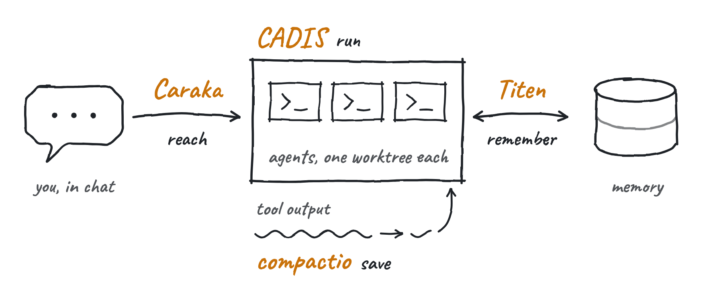

<p>
  <a href="https://ramadigital.id">
    <picture>
      <source media="(prefers-color-scheme: dark)" srcset="assets/hero-dark.webp">
      
    </picture>
  </a>
</p>

I build open-source tools that let AI coding agents run, remember, and take work from chat.<br/>
I also build attribution systems that connect ad spend to closed deals.

- **Managed marketing for small businesses** — AI agents run campaigns, ads, and landing pages for dozens of small businesses, automatically.
- **Private coaching in search** — SEO, AIO/AEO, and GEO: ranking on Google and being cited in AI answers.
- **1-on-1 mentoring** — private students, from engineering through go-to-market (GTM).

[ramadigital.id](https://ramadigital.id) · [halo@ramadigital.id](mailto:halo@ramadigital.id) · [LinkedIn](https://www.linkedin.com/in/ramaaditya49) · [WhatsApp](https://api.whatsapp.com/send?phone=6285803327994&text=Hi%20Rama%2C%20I%20found%20you%20on%20GitHub.)

[](https://www.npmjs.com/package/titen-memory)
[](https://www.npmjs.com/package/caraka)
[](https://www.npmjs.com/package/compactio)
[](https://www.npmjs.com/package/cloudflare-bulk-delete)
[](https://www.npmjs.com/package/@growthcircle/cadis)

<h3>
  <picture>
    <source media="(prefers-color-scheme: dark)" srcset="assets/label-stack-dark.webp">
    
  </picture>
</h3>

Four local-first pieces. Use one, or put them together.

<p>
  <picture>
    <source media="(prefers-color-scheme: dark)" srcset="assets/stack-dark.webp">
    
  </picture>
</p>

<table>
<tr>
<td width="50%" valign="top">

### [C.A.D.I.S.](https://github.com/Growth-Circle/cadis) 

**Run** — a multi-agent runtime in Rust. Desktop HUD, policy-gated tools, voice in and out, and coding agents that each work in their own git worktree.

`Rust` `Tauri` `React` — [cadis.digital](https://cadis.digital)

</td>
<td width="50%" valign="top">

### [Titen](https://github.com/RamaAditya49/titen) 

**Remember** — agent memory with no API key, no LLM, and no embedding provider. Serves MCP over SQLite, or Cloudflare Workers + D1 for a team. Each memory keeps its source, its readers, and the evidence against it.

```
npx titen-memory mcp
```

`TypeScript` `Bun` `SQLite` `MCP` — [titen.dev](https://titen.dev)

</td>
</tr>
<tr>
<td width="50%" valign="top">

### [Caraka](https://github.com/CarakaDev/caraka) 

**Reach** — send a task from Telegram, Discord, or WhatsApp to the coding agent on your machine. Caraka adds only what chat needs: identity, sessions, approvals, and audit.

```
npx caraka init
```

`ACP` `Node 22` — [caraka.dev](https://caraka.dev)

</td>
<td width="50%" valign="top">

### [compactio](https://github.com/RamaAditya49/compactio) 

**Save** — a System 1 for your coding agent. A fast decision model cuts test logs, build logs, and search results before the expensive model reads them. One real test log: 20,501 → 747 characters.

```
claude plugin marketplace add RamaAditya49/compactio
```

`TypeScript` `Claude Code plugin` · zero dependencies

</td>
</tr>
</table>

<h3>
  <picture>
    <source media="(prefers-color-scheme: dark)" srcset="assets/label-tools-dark.webp">
    
  </picture>
</h3>

<table>
<tr>
<td width="50%" valign="top">

<a href="https://github.com/RamaAditya49/cadiswave"></a>

### [CadisWave](https://github.com/RamaAditya49/cadiswave) 

Elgato Wave XLR software for Linux. Mic gain, mute, phantom power, headphones, and a PipeWire mixer. Continues [OpenWave](https://github.com/rikkichy/openwave).

`Rust` `GTK4` `libadwaita` `PipeWire`

</td>
<td width="50%" valign="top">

<a href="https://github.com/RamaAditya49/peta-pixel-nusantara"></a>

### [peta-pixel-nusantara](https://github.com/RamaAditya49/peta-pixel-nusantara) 

An 8-bit pixel map of Indonesia: 38 provinces and 514 regencies and cities on a zoomable canvas grid. Open data, no build step.

`Canvas` `TopoJSON` `geoBoundaries`

</td>
</tr>
<tr>
<td width="50%" valign="top">

### [cloudflare-bulk-delete](https://github.com/RamaAditya49/cloudflare-bulk-delete) 

Fixes the Cloudflare error *"Your project has too many deployments to be deleted"*. Deletes old Pages and Workers deployments and keeps production.

```
npx cloudflare-bulk-delete interactive
```

</td>
<td width="50%" valign="top">

### [kill-node-process](https://marketplace.visualstudio.com/items?itemName=RamaDigital.kill-node-process)

A VS Code extension. Find and stop Node.js processes from the status bar on Windows, Linux, and macOS.

</td>
</tr>
</table>

**Agent skills** — [rama-marketing](https://github.com/RamaAditya49/rama-marketing) *(Meta, Google, TikTok, and LinkedIn Ads)* · [rama-copywriting](https://github.com/RamaAditya49/rama-copywriting) · [rama-cs](https://github.com/RamaAditya49/rama-cs) *(customer service)* · [seng-jelas](https://github.com/RamaAditya49/seng-jelas) *(finds the patterns that make text read as AI slop)* · [tutur](https://github.com/RamaAditya49/tutur) and [bahasa-jelas-terkendali](https://github.com/RamaAditya49/bahasa-jelas-terkendali) *(natural Indonesian for LLMs)*

**MCP servers and plugins** — [coret-agent-kit](https://github.com/Rama-Digital/coret-agent-kit) · [biver-mcp](https://github.com/biver-colony/biver-mcp) · [grupy-mcp](https://github.com/ai-builders-id/grupy-mcp) · [konektor-plugin](https://github.com/Growth-Circle/konektor-plugin) · [gc-provider](https://github.com/Growth-Circle/gc-provider) · [openclaw-auth-wiper](https://github.com/Growth-Circle/openclaw-auth-wiper) · [utus](https://github.com/ai-builders-id/utus) · [ai-agentic](https://github.com/RamaAditya49/ai-agentic)

**Volara SDKs** — one omnichannel chat API: [TypeScript](https://github.com/volara-asia/volara-js) · [Python](https://github.com/volara-asia/volara-python) · [PHP](https://github.com/volara-asia/volara-php) · [Ruby](https://github.com/volara-asia/volara-ruby) · [Go](https://github.com/volara-asia/volara-go) · [WordPress](https://github.com/volara-asia/volara-wordpress) · [n8n](https://github.com/volara-asia/volara-n8n) · [MCP](https://github.com/volara-asia/volara-mcp) · [widget](https://github.com/volara-asia/volara-widget)

**Prompt collections** — [prd-prompt-collection](https://github.com/ai-builders-id/prd-prompt-collection) · [mdown-collection](https://github.com/ai-builders-id/mdown-collection)

**Forks I maintain** — [growcli](https://github.com/Growth-Circle/growcli) *(OpenAI Codex CLI)* · [grow-team](https://github.com/Growth-Circle/grow-team) *(Zulip)* · [take-my-computer](https://github.com/RamaAditya49/take-my-computer) *(computer use on Linux over MCP)*

<h3>
  <picture>
    <source media="(prefers-color-scheme: dark)" srcset="assets/label-products-dark.webp">
    
  </picture>
</h3>

<details>
<summary><b>10 live products</b>, mostly for Indonesian businesses</summary>

<br/>

| | Status | |
|---|:---:|---|
| [**Konektor**](https://konektor.id) | Live | Attribution from ad click to landing page to WhatsApp to closed deal, sent back to Google Ads and Meta Ads. |
| [**Coret**](https://coret.id) | Live | Mind maps and visual thinking with a public API: maps, nodes, sketches, and share links. |
| [**Biver**](https://biver.id) | Live | AI landing-page builder for small businesses. No code. |
| [**Volara**](https://volara.id) | Live | Omnichannel chat API with SDKs in six languages. *Co-built.* |
| [**Termilo**](https://termilo.com) | Live | Booking for service businesses, agencies, and SaaS teams. |
| [**Nayaka**](https://nayaka.studio) | Live | One brief in, a finished ad video out: script, Indonesian voice, SFX, music, captions, four ratios. Runs on your machine. |
| [**Nucifra**](https://nucifra.com) | Live | Gives a file your agent made a temporary public URL with the correct Content-Type. Video up to 4 GB. |
| [**Hermes Trading**](https://hermestrading.id) | Live | AI trading agent on Tokocrypto. Every decision and trade has a public proof hash. |
| [**sanji.space**](https://sanji.space) | Early access | Work chat for teams and AI agents in one room. |
| [**ongkir.online**](https://ongkir.online) | Live | Indonesian shipping-rate lookup. |

</details>

<h3>
  <picture>
    <source media="(prefers-color-scheme: dark)" srcset="assets/label-clients-dark.webp">
    
  </picture>
</h3>

<details>
<summary><b>5 public clients, 10 under NDA, 2 internal platforms</b></summary>

<br/>

**Public**

- [Waffles](https://waffles.id) — AI conversion assistant for websites. Astro edge worker, private Hono API over service bindings, Drizzle on several D1 databases, RAG ingestion, Durable Object quotas.
- Provaliant — campaign workspace for agencies: campaign board, staged workflow, AI video pipeline.
- [KotakFoto.id](https://kotakfoto.id) — storefront and organic social auto-poster.
- [Birojodoh Rumaysho](https://birojodoh.rumaysho.com) — ta'aruf (marriage introduction) platform, maintained since 2025.
- [AI Club Indonesia](https://aiclub.id) — community platform, Telegram ops bot, and automated video generator.

**Under NDA** (no names, only the shape of the work)

- Growth OS for a Hajj and Umrah travel operator: package catalog, leads routed to the nearest branch, and landing pages per region. Bun, Astro, Hono, Drizzle, Postgres.
- Settlement reconciliation for a multi-outlet F&B group: matches incoming payments against ShopeeFood, GoFood, GoPay, and GrabFood settlements from email.
- Delivery operations platform for a software agency: every paid engagement from blueprint to QA acceptance, with a production dashboard.
- Multi-tenant online course platform with payment callbacks and a service-token link to the platform above.
- Licensing and telemetry server for a desktop product.
- ERP for a manufacturing group.
- Attribution and lead-source tracking for a permit and licensing consultancy.
- Operations ERP for a health-supplement brand: inventory, stock aging, and orders from the TikTok Shop, Shopee, and Lazada APIs.
- Agentic CRM for an industrial bearings distributor: answers customers on WhatsApp and Telegram, reads stock from the accounting system, and drafts sales orders.
- Clinic marketplace and professional LMS for an optometry network.

**Internal platforms**

- Growth Circle: Meta Ads manager, webinar system, WhatsApp gateway, mail system, LiteLLM gateway, shared agent memory on Workers + D1 + Vectorize, and managed agent hosting.
- Rama Digital: ads reporting, SEO research gateway, ERP automation, and two video engines. `motion-engine` turns a design into an MP4 with voice, SFX, and music. `stick-animations` draws stick-figure films as pure SVG, with no video model.

</details>

<h3>
  <picture>
    <source media="(prefers-color-scheme: dark)" srcset="assets/label-results-dark.webp">
    
  </picture>
</h3>

I sell attribution, so I measure my own site the same way. **9 of 15 service pages on ramadigital.id rank on Google page 1.** The search `jasa install openclaw` ranks at position 1.1 with a 39% CTR.

<details>
<summary><b>9 service pages on page 1</b> (Google Search Console, 23 Jun – 22 Sep 2026)</summary>

<br/>

| Service page (Indonesian) | Avg. position |
|---|:---:|
| [AI SEO and GEO training](https://ramadigital.id/services/pelatihan-ai-seo-geo) | **3.7** |
| [Hermes Agent install](https://ramadigital.id/services/jasa-install-hermes-agent) | **5.1** |
| [Agentic AI training for schools and universities](https://ramadigital.id/services/pelatihan-ai-agentic) | **6.0** |
| [AI training for company teams](https://ramadigital.id/services/pelatihan-ai-perusahaan) | **6.7** |
| [OpenClaw install](https://ramadigital.id/services/jasa-install-openclaw) | **6.8** |
| [Local AI server for companies](https://ramadigital.id/services/local-ai-server-perusahaan) | **6.9** |
| [Web application development](https://ramadigital.id/services/web-application-development) | **7.5** |
| [Meta Ads system with AI](https://ramadigital.id/services/openclaw-meta-ads-operating-system) | **8.1** |
| [QwenPaw install](https://ramadigital.id/services/jasa-install-qwenpaw) | **8.4** |

After the home page, the most organic traffic comes from the agent install guides for [Windows](https://ramadigital.id/blog/cara-install-hermes-agent-di-windows), [Linux](https://ramadigital.id/blog/cara-install-hermes-agent-di-linux), and [macOS](https://ramadigital.id/blog/cara-install-hermes-agent-di-macos).

</details>

<h3>
  <picture>
    <source media="(prefers-color-scheme: dark)" srcset="assets/label-tech-dark.webp">
    
  </picture>
</h3>

**Languages** — Rust · Go · TypeScript · JavaScript · Python · PHP<br/>
**Frontend** — Vue · Nuxt · React · Next.js · Astro · Svelte · Tailwind<br/>
**Backend and data** — Node.js · NestJS · Bun · Laravel · Postgres · MongoDB · Redis<br/>
**Infrastructure and desktop** — Docker · Cloudflare · Linux · Git · Tauri
