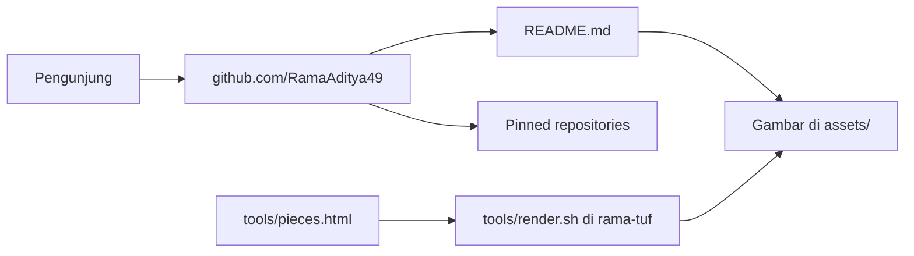

# Blueprint: RamaAditya49 (GitHub profile)

## Ringkasan

Repo ini adalah profile repo GitHub milik Rama Aditya. GitHub menampilkan `README.md` di halaman `github.com/RamaAditya49`.
Pembaca utama: developer, calon klien, dan rekan open source dari seluruh dunia.

## Status proyek

| Hal | Nilai |
|-----|-------|
| Tahap | produksi |
| URL produksi | https://github.com/RamaAditya49 |
| URL staging | Belum ada. |
| Repo | `RamaAditya49/RamaAditya49`, public |

## Peta sistem

## Stack

| Lapisan | Teknologi | Catatan |
|---------|-----------|---------|
| Konten | GitHub Flavored Markdown + HTML terbatas | GitHub membuang CSS dan script. |
| Gambar | WebP di `assets/` | Coretan kapur dan spidol dari `tools/pieces.html`. Kode menggambar semuanya. |
| Badge | shields.io | Unduhan npm dan jumlah bintang, warna `E8B04B`. |
| Render gambar | Chromium tanpa layar + ImageMagick + ffmpeg | Jalan di `rama-tuf` lewat `tools/render.sh`. Font OFL di `tools/fonts/`: Caveat. |
| Tema | `<picture>` dengan `prefers-color-scheme` | Tiap gambar punya berkas `-dark` (kapur) dan `-light` (spidol). |
| Animasi | WebP animasi, main satu kali | Hanya header. Frame pertama memuat nama. |

## Struktur repo

| Path | Isi |
|------|-----|
| `README.md` | Isi profil yang tampil di GitHub |
| `assets/` | 16 gambar WebP: 2 header, 2 sketsa agent stack, 12 label bagian |
| `tools/pieces.html` | Sumber semua gambar di `assets/` |
| `tools/render.sh` | Skrip yang menyimpan tiap gambar pada skala 2x |
| `tools/fonts/` | Font Caveat dan lisensi OFL |
| `internal/` | Jejak kerja: docs, spec, plan, done |

## Lingkungan dan deploy

| Lingkungan | URL | Host | Cara deploy |
|------------|-----|------|-------------|
| produksi | https://github.com/RamaAditya49 | GitHub | `git push origin main` |

Pinned repositories tidak ada di repo ini. Atur lewat UI GitHub: profil → "Customize your pins". GraphQL API tidak punya mutation untuk pin repo profil.

## Perintah penting

| Tujuan | Perintah | Jalan di |
|--------|----------|----------|
| Cek semua URL gambar dan link | `grep -oE 'https?://[^ )"<]+' README.md \| sort -u \| xargs -n1 curl -s -o /dev/null -w '%{http_code} %{url_effective}\n'` | mesin lokal |
| Salin sumber gambar ke `rama-tuf` | `rsync -az --delete --exclude out tools/ rama-tuf:scratch/profile-render/` | mesin lokal |
| Buat ulang gambar | `ssh rama-tuf 'bash -lc "cd ~/scratch/profile-render && systemd-run --user --scope -q -p MemoryMax=8G -p MemorySwapMax=0 bash render.sh"'` | `rama-tuf` |
| Ambil hasil | `rsync -az rama-tuf:scratch/profile-render/out/*.webp assets/` | mesin lokal |
| Lihat satu gambar di browser | Buka `tools/pieces.html?p=hero&theme=dark&t=2`. `p=all` menampilkan semua gambar. Tanpa `t`, gambar tampil lengkap. | `rama-tuf` |
| Baca pin saat ini | `gh api graphql -f query='{ user(login:"RamaAditya49"){ pinnedItems(first:6){ nodes{ ... on Repository{ nameWithOwner } } } } }'` | mesin lokal |

## Integrasi luar

| Layanan | Untuk apa | Lokasi kredensial (tanpa nilai) |
|---------|-----------|---------------------------------|
| GitHub | Hosting profil | `gh` CLI auth di mesin lokal |

## Pertanyaan terbuka

- Tidak ada.

## Sumber fakta

- `gh api users/RamaAditya49` (2026-10-26)
- `git log --oneline` repo ini (2026-10-26)
- GraphQL introspection: tidak ada mutation pin repo (2026-10-26)
- `tools/pieces.html`, `tools/render.sh`, dan `ls assets` (2026-11-12)
- Kanvas rancangan: https://claude.ai/artifact/Km9nhGURtQn1MqJudFgDvN (2026-11-12)
- README publik lain yang memakai `<picture>` dengan path relatif: `sveltejs/svelte`, dibaca lewat `gh api repos/sveltejs/svelte/readme` (2026-11-12)
