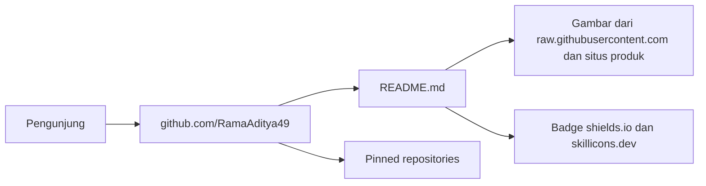

# Blueprint: RamaAditya49 (GitHub profile)

## Ringkasan

Repo ini adalah profile repo GitHub milik Rama Aditya. GitHub menampilkan `README.md` di halaman `github.com/RamaAditya49`.
Pembaca utama: developer, calon klien, dan rekan open source dari seluruh dunia.

## Status proyek

| Hal | Nilai |
|-----|-------|
| Tahap | produksi |
| URL produksi | https://github.com/RamaAditya49 |
| URL staging | Belum ada. |
| Repo | `RamaAditya49/RamaAditya49`, public |

## Peta sistem

## Stack

| Lapisan | Teknologi | Catatan |
|---------|-----------|---------|
| Konten | GitHub Flavored Markdown + HTML terbatas | GitHub membuang CSS dan script. |
| Badge | shields.io, skillicons.dev | Layanan luar. Badge bisa gagal render. |
| Gambar | SVG dan PNG dari repo proyek | Link absolut ke `raw.githubusercontent.com`. |

## Struktur repo

| Path | Isi |
|------|-----|
| `README.md` | Isi profil yang tampil di GitHub |
| `internal/` | Jejak kerja: docs, spec, plan, done |

## Lingkungan dan deploy

| Lingkungan | URL | Host | Cara deploy |
|------------|-----|------|-------------|
| produksi | https://github.com/RamaAditya49 | GitHub | `git push origin main` |

Pinned repositories tidak ada di repo ini. Atur lewat UI GitHub: profil → "Customize your pins". GraphQL API tidak punya mutation untuk pin repo profil.

## Perintah penting

| Tujuan | Perintah | Jalan di |
|--------|----------|----------|
| Cek semua URL gambar dan link | `grep -oE 'https?://[^ )"<]+' README.md \| sort -u \| xargs -n1 curl -s -o /dev/null -w '%{http_code} %{url_effective}\n'` | mesin lokal |
| Baca pin saat ini | `gh api graphql -f query='{ user(login:"RamaAditya49"){ pinnedItems(first:6){ nodes{ ... on Repository{ nameWithOwner } } } } }'` | mesin lokal |

## Integrasi luar

| Layanan | Untuk apa | Lokasi kredensial (tanpa nilai) |
|---------|-----------|---------------------------------|
| GitHub | Hosting profil | `gh` CLI auth di mesin lokal |

## Pertanyaan terbuka

- Tidak ada.

## Sumber fakta

- `gh api users/RamaAditya49` (2026-10-26)
- `git log --oneline` repo ini (2026-10-26)
- GraphQL introspection: tidak ada mutation pin repo (2026-10-26)
