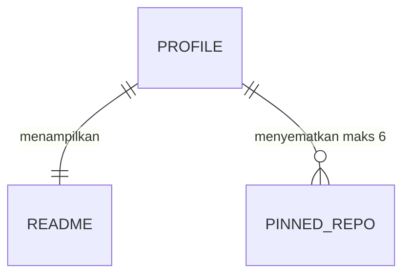

# ERD: RamaAditya49 (GitHub profile)

## Penyimpanan data

| Penyimpanan | Teknologi | Lokasi | Isi |
|-------------|-----------|--------|-----|
| README | Markdown | `README.md` | Konten profil |
| Pin profil | Pengaturan akun GitHub | UI GitHub | Daftar 6 repo |

Proyek ini tidak memakai database.

## Diagram

## Entitas

### PINNED_REPO

| Field | Tipe | Wajib | Catatan |
|-------|------|-------|---------|
| `nameWithOwner` | string | ya | Repo public milik Rama atau org tempat Rama berkontribusi |

## Indeks dan constraint

- GitHub membatasi pin profil maksimal 6.

## Migrasi

- Lokasi migrasi: `Tidak ada.`
- Cara menjalankan: `Tidak ada.`

## Data pribadi dan retensi

- README memuat email kerja dan nomor WhatsApp bisnis yang Rama pakai untuk publik. Tidak ada PII lain.

## Pertanyaan terbuka

- Tidak ada.

## Sumber fakta

- Dokumentasi GitHub tentang pinned items (maks 6)
